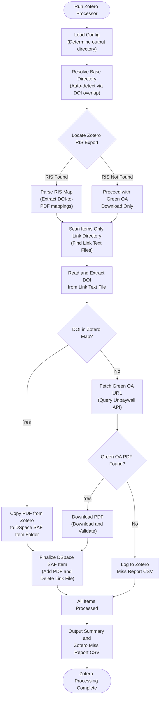

# FedHarv Workflow Visualization

This document details the architecture, module relationships, and execution sequences for the **FedHarv (Federated Open Access Harvester)** codebase.

---

## 1. Core Harvesting & Orchestration Pipeline

The main execution flow is orchestrated by [run_harvester.py](file:///home/pvcalarco/FedHarv/src/run_harvester.py) which initializes the `Harvester Engine`.

Below is the workflow visualization showing the sequential stages from startup and cleaning, to concurrent API discovery, strict filtering, multi-tier PDF waterfall attempts, Playwright fallback, and final DSpace Simple Archive Format (SAF) creation and cleanup.

```mermaid
%%{init: {'themeVariables': { 'fontSize': '24px', 'labelFontSize': '20px' }}}%%
graph TD
    %% Entrypoint
    Start([Run Harvester]) --> Init[Initialize Harvester Engine]
    
    %% Initialization and Cleanup
    Init --> Setup["Setup Logging and<br>Initialize Stats"]
    Setup --> Cleanup{"Resume Mode?"}
    Cleanup -- "No (Fresh Run)" --> Robust Clean["Robust Cleanup of <br>Output Directory<br>(Preserves Cache)"]
    RobustClean --> CleanStale["Cleanup Empty <br>Item Directories<br>(Prunes stale folders)"]
    CleanStale --> InitRIS["Initialize Empty <br>RIS Citation File"]
    Cleanup -- "Yes" --> PreserveDirs["Preserve Existing <br>Output"]
    
    %% Preparation
    InitRIS & PreserveDirs --> GenImport["Generate Import Scripts<br>(Creates DSpace SAF shell scripts)"]
    
    %% Phase 1: Federated Discovery
    GenImport --> Discov["Discover<br>Concurrent API Harvesting"]
    Discov --> HarvestOA[Harvest OpenAlex API]
    Discov --> HarvestCR[Harvest CrossRef API]
    
    %% Phase 2: Deduplication and Merging
    HarvestOA & HarvestCR --> Dedupe["Deduplicate and Merge<br>(Merges by DOI or Title)"]
    Dedupe --> DryRunCheck{Dry Run?}
    DryRunCheck -- "Yes" --> DryRunEnd([Dry Run Complete])
    DryRunCheck -- "No" --> Process["Process Items<br>(Thread Pool: 15 Threads)"]
    
    %% Phase 3: Per-Item Processing
    Process --> ProcessItem[Process Item]
    ProcessItem --> DupCheck{Check DSpace Duplicate}
    DupCheck -- "Duplicate" --> LogDup["Log and<br>Increment Stats"]
    DupCheck -- "New" --> DOIRecover["DOI Recovery<br>(Lookup DOI by Title)"]
    DOIRecover --> Enrich["Fetch Enrichment Batch<br>(Parallel API Queries)"]
    Enrich --> OAFilter{"Strict Open Access Filter<br>(Skip Closed/Bronze/Unknown)"}
    OAFilter -- "Closed / Bronze" --> SkipItem[Skip Item]
    OAFilter -- "Gold / Hybrid / Diamond / Green" --> ExtractAuthors["Extract Authors and<br>Check Affiliation"]
    ExtractAuthors --> MapDC[Map Metadata to Dublin Core]
    MapDC --> DirAssign{Determine Target Folder}
    DirAssign -- "Items with PDF / Green (with PDF)" --> PDFWaterfall[Fetch PDF with Waterfall]
    PDFWaterfall --> PDFSuccessCheck{Download Success?}
    PDFSuccessCheck -- "Yes" --> FinalizePDF["Finalize PDF Item<br>(Move PDF and Write SAF)"]
    PDFSuccessCheck -- "No" --> QueuePlaywright["Queue for<br>Playwright Fallback"]
    DirAssign -- "Items Only Link / Green (no PDF)" --> WriteLink["Create Link Text File<br>and Write SAF"]
    
    %% Phase 4: Playwright Fallback & Finalization
    QueuePlaywright --> PlaywrightRun["Process Playwright Queue<br>(Headless Browser Fallback)"]
    PlaywrightRun --> FinalizePlaywright["Finalize Items with<br>Downloaded PDFs"]
    
    %% Phase 5: Exporters & Final Cleanup
    FinalizePDF & WriteLink & FinalizePlaywright --> CloseHandles[Close Exporter Handles]
    CloseHandles --> FinalCleanup["Cleanup Empty Collection<br>Directories (Pruning)"]
    FinalCleanup --> Summary["Generate Summary and<br>Publisher Report"]
    Summary --> End([Harvest Engine Complete])
```

---

## 2. Zotero & Green OA Fallback Post-Processing Workflow

For harvested items where no PDF could be fetched automatically during the core run, FedHarv generates a `citations.ris` file. This is imported into Zotero to let researchers/librarians locate PDFs. The Zotero exports are then parsed by [process_zotero_pdfs.py](file:///home/pvcalarco/FedHarv/src/process_zotero_pdfs.py).

Below is the workflow visualization showing how the Zotero post-processor maps local exported files, falls back to Unpaywall Green OA queries if necessary, upgrades the SAF packages to include the PDFs, and updates the DSpace import metadata.


